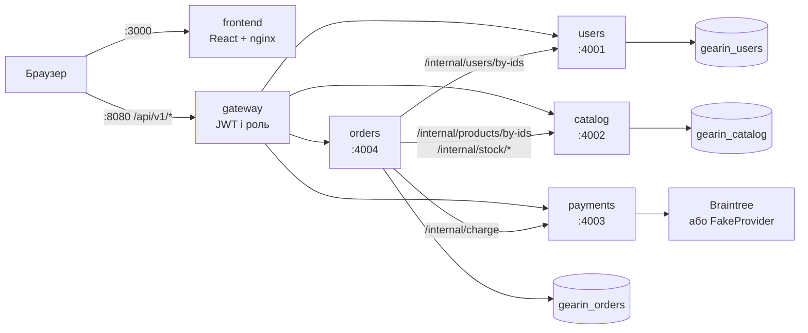

<a name="readme-top"></a>

<div align="center">
  
  <h3>GearIN</h3>
  <p>Інтернет-магазин на MERN, перебудований із моноліту в сервісну архітектуру за патерном Strangler Fig</p>
</div>

## Зміст

- [Архітектура](#архітектура)
- [Сервіси та порти](#сервіси-та-порти)
- [Запуск](#запуск)
- [Перенесення даних](#перенесення-даних)
- [Тести](#тести)
- [Патерни](#патерни)
- [Структура репозиторію](#структура-репозиторію)
- [Ліцензія](#ліцензія)

## Архітектура

Браузер звертається лише до шлюзу. Шлюз перевіряє JWT і роль, передає сервісам заголовки `x-user-id` та `x-user-role` і видаляє такі самі заголовки, надіслані клієнтом. Сервіси спілкуються між собою лише через HTTP/JSON, кожен зі своєю базою.



Маршрути `/internal/*` шлюз не пропускає, вони доступні лише всередині мережі Docker.

### Оформлення замовлення

Клієнт надсилає лише `productId`, `quantity` і `nonce`. Ціни сервер бере з каталогу.

1. `orders` отримує назви й ціни з `catalog`.
2. `catalog` резервує залишки: або всі позиції, або жодної.
3. `orders` рахує суму та викликає `payments`.
4. Якщо оплата успішна, зберігається замовлення зі знімком позицій. Якщо ні, резерв повертається.

## Сервіси та порти

| Сервіс | Порт | Опублікований назовні | База | Відповідає за |
|---|---|---|---|---|
| `frontend` | 80 (на хості 3000) | так | — | клієнт React |
| `gateway` | 8080 | так | — | єдина точка входу, JWT, роль, маршрутизація |
| `users` | 4001 | ні | `gearin_users` | реєстрація, вхід, профіль, відновлення пароля |
| `catalog` | 4002 | ні | `gearin_catalog` | категорії, товари, фото, залишки |
| `payments` | 4003 | ні | немає | токен клієнта, списання коштів |
| `orders` | 4004 | ні | `gearin_orders` | оформлення та історія замовлень |

| Шлях на шлюзі | Сервіс |
|---|---|
| `/api/v1/auth/register`, `login`, `forgot-password`, `profile`, `user-auth`, `admin-auth` | `users` |
| `/api/v1/category/*`, `/api/v1/product/*` | `catalog` |
| `/api/v1/product/braintree/token` | `payments` |
| `/api/v1/auth/orders`, `all-orders`, `order-status/:id`, `/api/v1/product/braintree/payment` | `orders` |

## Запуск

Потрібні Docker із Compose і база MongoDB, наприклад кластер MongoDB Atlas.

1. Створіть файл налаштувань і заповніть його:

   ```sh
   cp .env.example .env
   ```

   | Змінна | Значення |
   |---|---|
   | `MONGO_URL` | адреса MongoDB з назвою старої бази в шляху, наприклад `.../gearin`. Сервіси самі перемикаються на власні бази, а стара база є джерелом для перенесення даних |
   | `JWT_SECRET` | секрет для підпису токенів |
   | `PAYMENT_PROVIDER` | `braintree` або `fake` |
   | `BRAINTREE_*` | ключі пісочниці Braintree, потрібні лише для `braintree` |

2. Запустіть усі контейнери:

   ```sh
   docker compose up --build
   ```

3. Перенесіть дані, якщо вони є в старій базі (див. нижче).

4. Відкрийте [http://localhost:3000](http://localhost:3000). API доступне за адресою `http://localhost:8080`.

Адреса шлюзу вбудовується в клієнт під час збірки. Її задає `REACT_APP_API_URL` у `docker-compose.yml`.

З `PAYMENT_PROVIDER=fake` сервіс платежів працює без ключів, але форма оплати Braintree у браузері не прийме фальшивий токен. Цей режим призначений для тестів і перевірки API.

### Запуск без Docker

У кожному сервісі є файл `.env.example`. Скопіюйте його в `.env` поруч, заповніть і запустіть:

```sh
npm run install:all
cd services/users && npm start
```

Те саме зробіть для `catalog`, `payments`, `orders` і `gateway`, а клієнт запустіть командою `npm start` у папці `Frontend`.

## Перенесення даних

Скрипти копіюють дані зі старої бази в бази сервісів. Запускати їх можна повторно: наявні записи вони не перезаписують.

```sh
docker compose run --rm users node scripts/migrate-users.js
docker compose run --rm catalog node scripts/migrate-catalog.js
docker compose run --rm orders node scripts/migrate-orders.js
```

Під час перенесення відповіді на секретні питання хешуються, а старі замовлення отримують знімок позицій із поточними назвами й цінами товарів.

## Тести

Перед першим запуском встановіть залежності, потім запустіть усі набори з кореня:

```sh
npm run install:all
npm test
```

| Набір | Що перевіряє |
|---|---|
| `services/*`, `npm test` | кожен сервіс окремо: патерни, маршрути, міграції |
| `legacy/Backend`, `npm test` | характеризаційні тести поведінки старого моноліту |
| `legacy/Backend`, `npm run test:gateway` | ті самі сценарії та повне оформлення замовлення через шлюз і всі сервіси |
| `Frontend`, `npm test` | формування позицій замовлення з кошика |

Базу MongoDB для тестів піднімає `mongodb-memory-server`, Braintree замокано.

## Патерни

| Патерн | Де |
|---|---|
| Singleton | `Config` у кожному сервісі, `Database` у сервісах із базою, `Logger` у шлюзі |
| Factory Method | `ProviderFactory` створює `BraintreeProvider` або `FakeProvider` |
| Abstract Factory | `StorageFactory`: `MongoStorageFactory` та `InMemoryStorageFactory` |
| Builder | `ProductQueryBuilder`, `OrderBuilder` |
| Prototype | `Product.clone(overrides)` |

## Структура репозиторію

```text
.
├── Frontend/            клієнт React
├── services/
│   ├── gateway/         шлюз API
│   ├── users/           користувачі
│   ├── catalog/         каталог
│   ├── payments/        платежі
│   └── orders/          замовлення
├── legacy/Backend/      старий моноліт і характеризаційні тести, у запуску не бере участі
├── Assets/              логотип і дамп даних MongoDB
└── docker-compose.yml
```

## Ліцензія

Поширюється за ліцензією MIT. Див. файл `LICENSE`.

<p align="right">(<a href="#readme-top">на початок</a>)</p>
